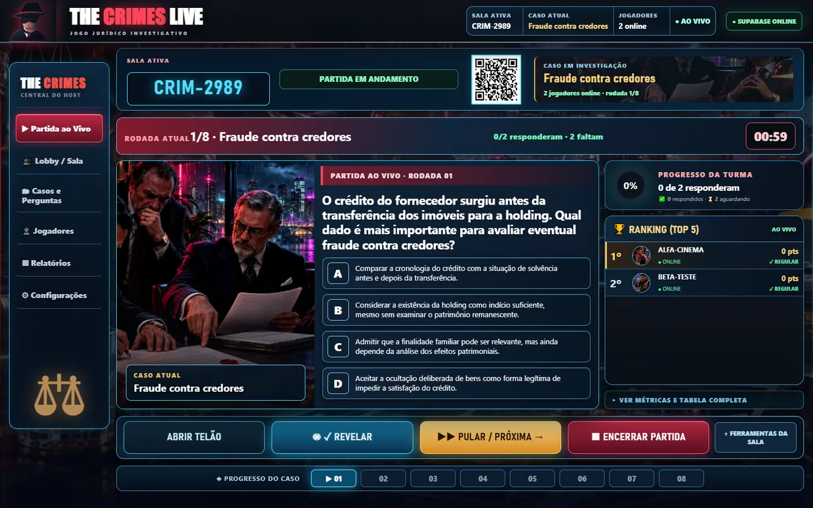
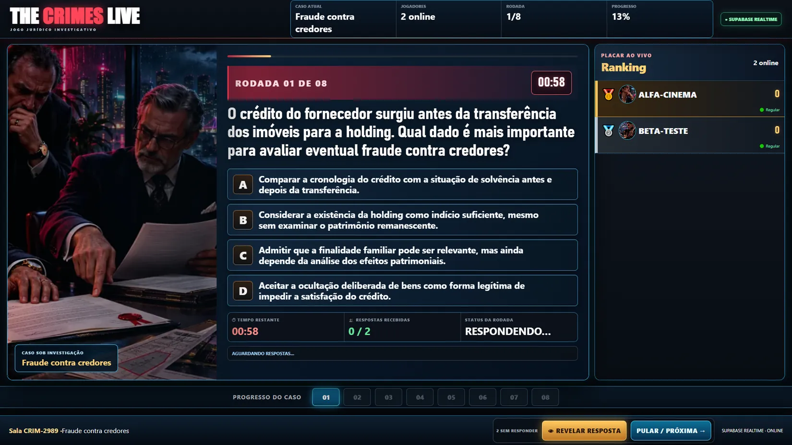
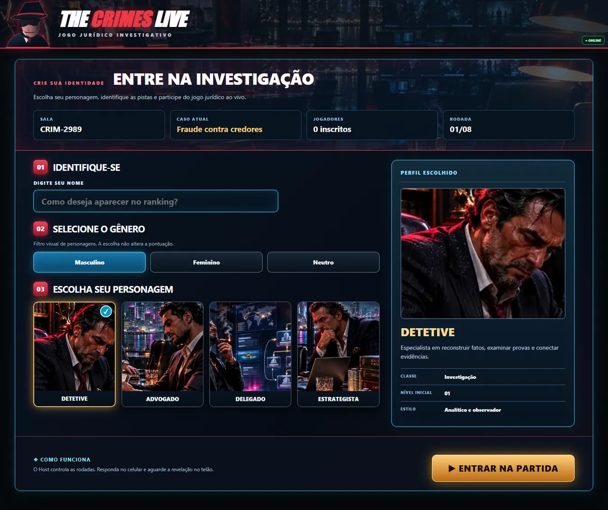
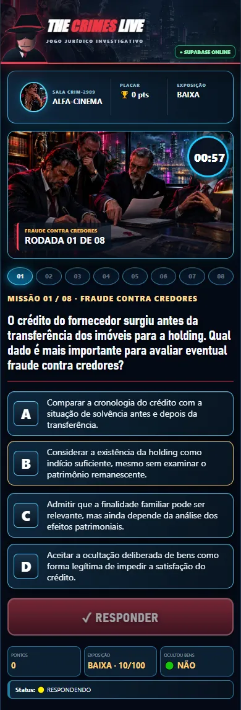

# THE CRIMES LIVE — UX Premium V4.0

**Data:** 11/11/2026  
**Base:** V3.9.0 cinematicamente funcional  
**Repositório:** `rafaelmsp/holding-studio-educacional`  
**Endereço:** https://rafaelmsp.github.io/holding-studio-educacional/live/?view=host

## Objetivo

Revisar o frontend real do jogo online à luz dos quatro modelos aprovados (central do professor, telão, celular e entrada/seleção de personagem). A prioridade é tornar a interface organizada, legível, cinematográfica e funcional sem alterar regras da partida.

## Problemas encontrados na versão anterior

| Tela | Falha observada | Correção V4.0 |
|---|---|---|
| Host | Cabeçalho pequeno e falta de hierarquia | Cabeçalho de marca com símbolo, sala, caso, participantes e status real |
| Host | 12 controles igualmente destacados | Ações principais no dock e outras em **Ferramentas da sala**; handlers originais preservados |
| Host | Tabela extensa e apertada ao lado da pergunta | Ranking Top 5 com avatares e pontos reais; tabela detalhada e métricas em seção expandível |
| Host | Comandos exigindo rolagem | Layout condensado para manter dock e etapas no viewport de 1440×900 durante partida padrão |
| Telão | Grande área ociosa e alternativas pequenas | Cena e questão lado a lado, fontes e respostas maiores, status, ranking e barra de etapas |
| Telão | Relógio inferior vazio | Sincroniza a exibição do tempo inferior ao contador superior da própria tela |
| Celular | Marca e personagem pouco valorizados | Header cinematográfico, perfil com retrato e contador sobre a cena |
| Celular | Botão RESPONDER sobrepunha alternativas durante rolagem | Botão no fluxo normal, sempre **após** as quatro opções |
| Entrada no desktop | Layout preso à largura de celular | Página ampla com catálogo e prévia em duas colunas; celular mantém layout vertical |
| Identidade | Iconografia/cores inconsistentes | Paleta centralizada em azul/ciano, vermelho e dourado; marca de detetive local em SVG |

## Estrutura técnica

- `live/ux-v40.css` — nova camada de layout responsiva e hierarquia visual.
- `live/app.js` — reposicionamento controlado de elementos já existentes, ranking real, estado visual do telão, tela de entrada desktop e relógio inferior. Nenhum método RPC de jogo foi modificado.
- `live/index.html` — referência ao CSS V4.0 e versão nova de cache do bundle.
- `assets/the-crimes-v3/ui/detective-mark.svg` — símbolo original de marca em SVG local.
- `tests/live-ux-v40.test.js` — contrato de UI e de integridade de assets, executado no CI.
- `docs/preview/v40` — capturas de teste para conferência.

## Regras preservadas

48 perguntas, seis casos, Host, telão, QR, modo individual, Presence, reconexão, room_revision, round_key, envio idempotente, bloqueio, revelação, pausa, avanço, ranking e pódio. Os valores exibidos vêm exclusivamente do backend; não são números fixos ilustrativos.

## Testes

Validação com Chrome automatizado, sala online real, Host 1440×900, telão 1920×1080, celular 390×844 e 412×915, entrada 1440×900, dois jogadores independentes, revelação, PULAR/PRÓXIMA e resultado final.

A suíte inclui, além do fluxo, verificações de overflow horizontal, visibilidade dos controles prioritários no Host, posição do botão RESPONDER após a última alternativa, campo de seleção em desktop e relógio inferior do telão.

## Limitações conhecidas

Os backgrounds e os retratos ainda são cenas da biblioteca própria existente; o ambiente fotográfico de mansão dos conceitos é uma direção de arte, **não foi inserido como fotografia recortada do mockup**, pois o texto e os botões dessas imagens não devem ser confundidos com elementos interativos. A V4.0 privilegia controles reais. Não foi realizado teste de carga com 30–50 alunos nem homologação em todos os navegadores.

## Abrir

- **Host:** https://rafaelmsp.github.io/holding-studio-educacional/live/?view=host
- **Telão autorizado:** clicar em **ABRIR TELÃO** dentro do Host. Abrir apenas `?view=screen` sem token não concede administração.
- **Celular:** escanear o QR da sala criada.

## Capturas reais de interface (teste automatizado V4.0)

Os códigos CRIM das capturas são salas temporárias de teste. As imagens mostram componentes HTML reais, não mockups estáticos.

| Central do Host | Telão | Celular | Entrada | Resultado |
|---|---|---|---|---|
| [Visualizar](preview/v40/host.webp) | [Visualizar](preview/v40/telao.webp) | [Visualizar](preview/v40/jogador.webp) | [Visualizar](preview/v40/entrada.webp) | [Visualizar](preview/v40/resultado.webp) |

